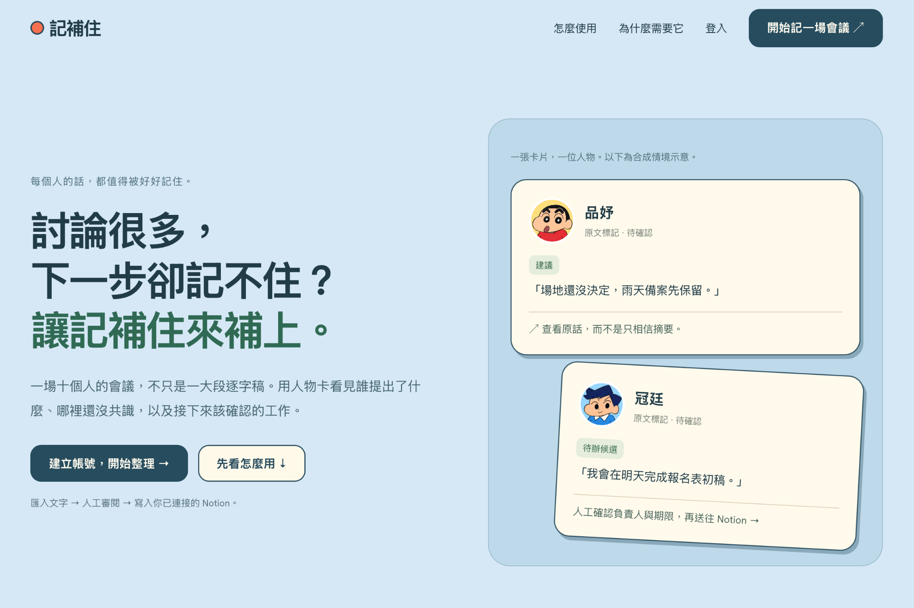

# 記補住

**因為記不住，所以幫你補住。** 用人物卡回找多人會議中的重點、建議、異議與待辦，核對原文後再交付至 Notion。

[展示頁原始檔（下載後開啟）](docs/index.html) · [驗收範圍](docs/verification.md)

> 這是產品原始碼儲存庫，尚未部署可直接登入的雲端網站。GitHub 的 HTML 檔案頁不會執行互動展示；請依下方指令先啟動本機服務，再開啟產品或展示頁。



> 產品封面使用使用者確認的落地頁首屏；右側內容為合成會議示意。

## 能做什麼

- 貼上或匯入 UTF-8 `.txt`／`.md` 逐字稿，最多 45,000 字元。
- 每位人物或原文標記有獨立卡片，可改顯示名稱、選角色頭像或匯入自己的圖片。原文與身分狀態保留。
- 明確同意後，由 DeepSeek 或 OpenAI 整理全文；長文分塊，逐項檢查引文行號與文字。
- 從人物卡追問重點與承諾、比較不同人的意見、查詢未決事項，或自由修改問題。
- 人工採納待辦、填寫負責人、確認期限，再預覽並寫入已設定的 Notion 資料庫。支援防重與獨立讀回核對。
- 本機註冊、登入、登出與個人資料保存；密碼 salted scrypt，登入 token 僅以雜湊保存。

## 啟動

需要 **Node.js 24 或更新版本**。發佈快照使用 Node 內建 HTTP、SQLite 與 TypeScript strip-types；執行及測試不需要額外套件。

```sh
git clone https://github.com/ccbibo/jibuzhu.git
cd jibuzhu
npm run start:background
```

啟動後開啟 [產品入口](http://127.0.0.1:4173/welcome) 或 [產品展示](http://127.0.0.1:4173/showcase/)。首次使用選「建立帳號」。本機網址只在已啟動服務的電腦上有效；若設定替代連接埠，請使用終端機顯示的網址。

若要前景執行、方便查看日誌：

```sh
npm start
# 等效前景指令：npm run start:local
```

背景啟動器只監聽 `127.0.0.1`，重複啟動會先檢查服務；不停止其他程序。日誌在 `outputs/local-server.log`。替代連接埠可用 `ACTIONDESK_PORT` 設定。

## 使用順序

1. 在「匯入會議」貼逐字稿或選文字檔，建立總覽。
2. 點人物頭像卡查看內容。選擇 AI 整理／問答時，先核對供應商並同意傳送全文。
3. 將明確工作「納入追蹤」。上方會更新可審閱項目數。
4. 按「審閱並寫入 Notion」，確認內容、負責人、日期及目的地後送出。
5. 使用「獨立讀回核對」確認 Notion 實際內容，必要時匯出完整會議備份。

## 串接自己的 AI 與 Notion

規則整理不需金鑰。真實服務設定請將 `.dev.vars.example` 複製成 `.dev.vars`，填好後重啟服務；**真實金鑰、帳號資料庫與私人逐字稿不在此儲存庫**。

| 變數 | 用途 |
|---|---|
| `AI_PROVIDER` | `deepseek` 或 `openai` |
| `DEEPSEEK_API_KEY` / `DEEPSEEK_MODEL` | DeepSeek 服務端憑證與模型 |
| `OPENAI_API_KEY` / `OPENAI_MODEL` | OpenAI 服務端憑證與模型 |
| `NOTION_TOKEN` | 你自己的 Notion 整合 token |
| `NOTION_DATA_SOURCE_ID` | 已授權任務資料來源 ID |
| `NOTION_CLAIM_PAGE_ID` | 選用：讀取指定頁面頂層認領留言 |

AI 模型也可由登入管理員在 `/settings` 設定。Notion 資料庫需分享給整合，必要欄位為任意名稱的 Title 與「來源 ID」rich_text；選用「負責人」rich_text、「截止日期」date、「優先級」select（高／一般／低）。負責人以文字記錄，不自動指派 Notion 成員。

換 AI 供應商或模型必須重新同意，不跨供應商套用另一把金鑰。連線檢查只讀取目標結構；寫入須人工審閱。來源相同的 pending／uncertain 收據不盲目重建。

## 驗證

```sh
npm test
```

自動化回歸 **379 項：379 通過、0 略過、0 失敗**；另有 **S10 真人驗收通過**，依使用者本人於 2026-11-01 的確認記錄，詳見 [人工驗收紀錄](docs/acceptance/notion-owner.md)。包含真 SQLite、本機 HTTP、實際頁面腳本的 VM 回歸及受控供應商回應；不把 mock 當成真人或外部 API 證據。

另有合成內容的真實 DeepSeek 短／長文與人物問答紀錄，以及 Notion 真實寫入、獨立讀回、重送防重紀錄。私人 Notion 連結及帳號截圖不隨產品發佈。[詳細範圍與剩餘限制](docs/verification.md)。

## 範圍與限制

- 目前是**電腦本機版**，不是已部署的多人 SaaS。沒有多人即時共編、跨裝置會議同步、信箱驗證或忘記密碼流程。
- 帳號名字與頭像由本機 SQLite 保存；會議原文、人物視覺別名與人工追蹤暫存在同分頁工作階段，請匯出備份。其他人登入不會還原上一帳號的原文。
- 人物改名與頭像不是本人認領。Notion 留言預覽缺少完整刪除／已解決歷史，不能當作正式的身分帳本。
- 逐字引用吻合不保證語意正確；不同意見、跨段修正、決議與任務完成都需人工確認。模型回報完成不會自動勾選任務。
- 人工進度尚未同步到 Notion 狀態欄；任務寫入成功不等於整個工作台已永久同步。
- 自訂圖片曾因 CSP 阻擋本機預覽；已加入限定的 blob 圖片來源，修後原生瀏覽器複驗尚未完成。公開服務部署仍需另外完成 HTTPS、安全與多使用者架構驗收。

## 展示與素材

`docs/index.html` 是可獨立開啟的產品展示，含固定合成資料的互動導覽。完整產品啟動後也可開 `/showcase/`；導覽不會呼叫 AI 或寫入 Notion。

頭像為生成式角色插畫，用於這份作品的視覺識別，並非使用者真實照片。字型授權附於 `public/assets/fonts/`。本儲存庫為經挑選的產品快照，不含開發期間的私人驗收歷史。
